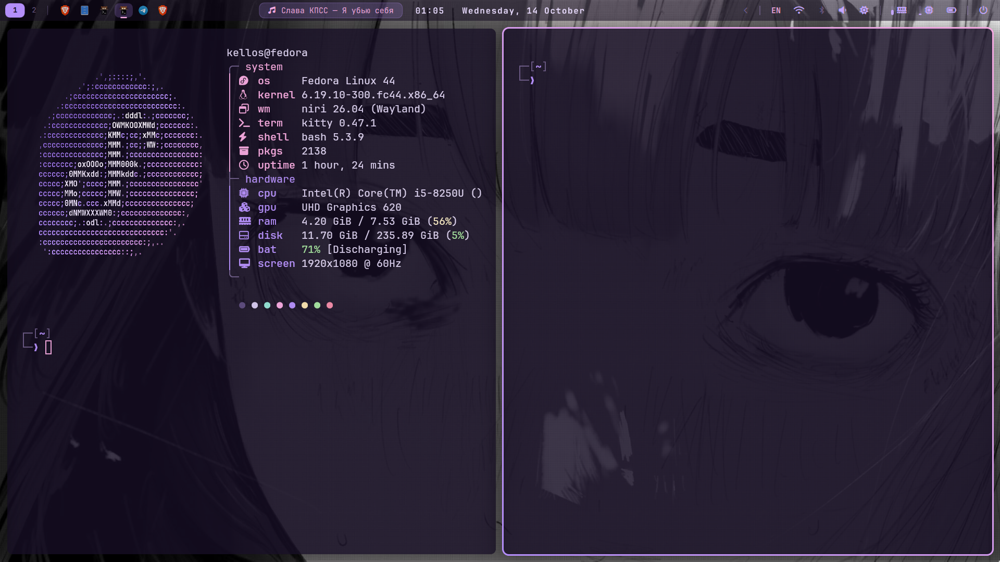

# Kellos rice



Fedora 44 · **niri** · **Quickshell** · waybar · kitty · LazyVim — всё в фиолетовой палитре.

| | |
|---|---|
| фон | `#160e24` |
| мов | `#b48efa` |
| лиловый | `#c4a7ff` |
| розовый | `#f5a9e0` |
| текст | `#e0d4f5` |

## Что внутри
- `config/quickshell/kellos-music` — своя панель на QML: плеер, окна и рабочие столы, Wi-Fi, Bluetooth
  (с шумодавом для realme/OPPO), календарь с напоминаниями, монитор системы, меню питания, трей с меню
- `config/niri` — оконный менеджер, хоткеи, автозапуск
- `config/nvim` — LazyVim с фиолетовой подсветкой под общую палитру
- `config/fastfetch` — ASCII-логотип Fedora в градиенте
- `config/Kvantum/Kellos` — тема Qt-приложений (перекраска KvArcDark, GPL)
- `bin/ks` — раскладывает рабочее место одной командой
- `bin/buds` — шумоподавление realme Buds из терминала
- `stylus/` — темы для claude.ai и GitHub

## Установка
```bash
git clone https://github.com/Kell0s/dotfiles ~/dotfiles && bash ~/dotfiles/install.sh
```
Quickshell (`noctalia-qs`) и Throne ставятся отдельно.

